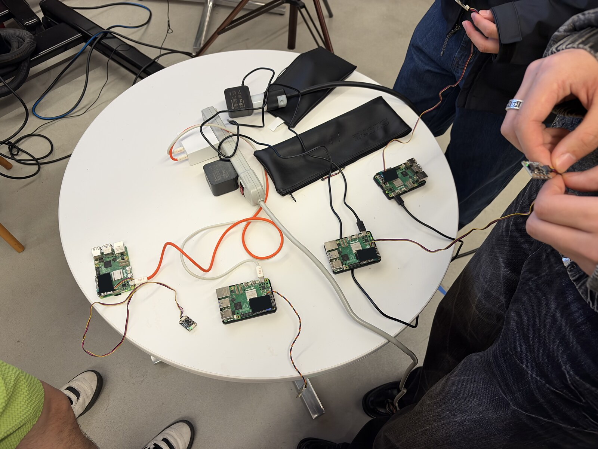
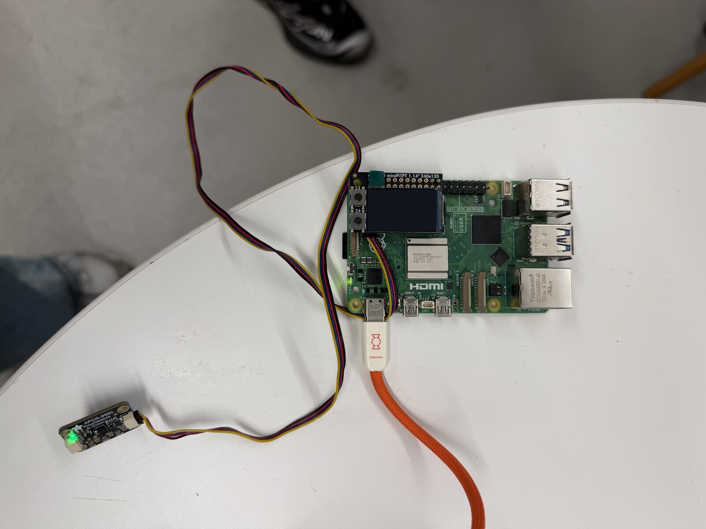
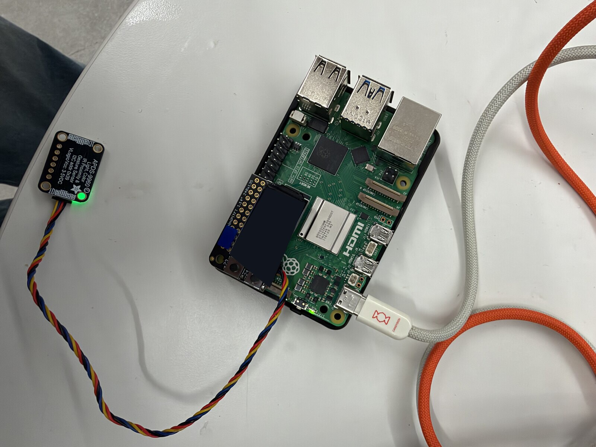
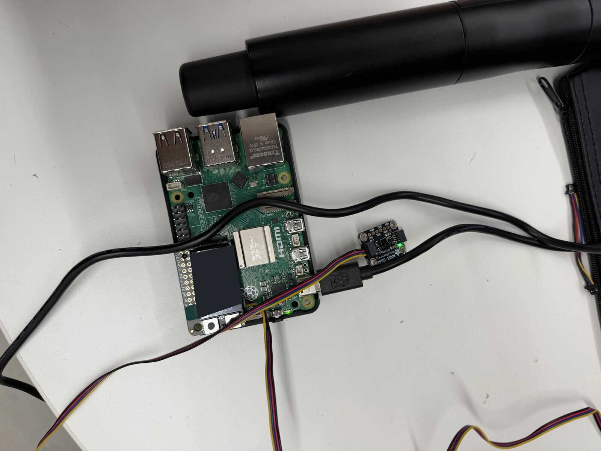
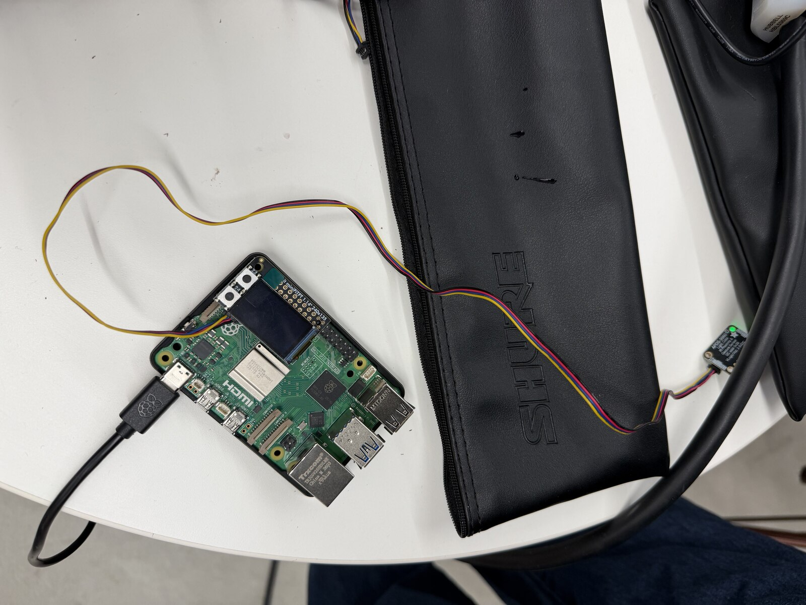
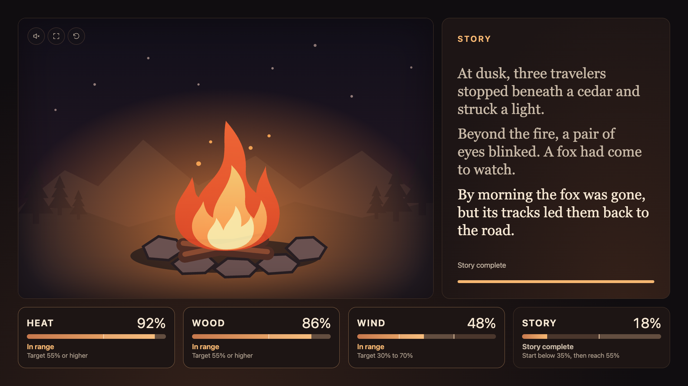
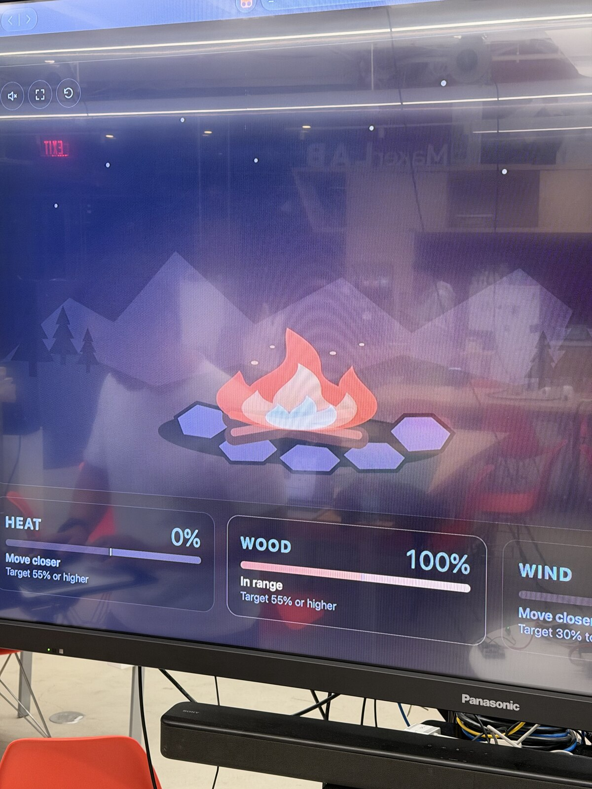
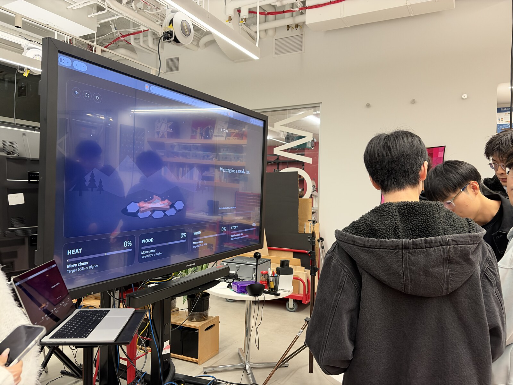

# Distributed Interaction

**Team:** Jiesen Huang, Serena Tsai, Yuge Xu, Youzhu Jin, Zijii Zhang, and Terence Zhang

[Course instructions](https://github.com/IRL-CT/Interactive-Lab-Hub/blob/Fall2026/Lab%206/README.md) · [Shared team documentation](https://github.com/certaindragon3/Interactive-Lab-Hub/blob/Fall2026/Lab%206/README.md)

## Part A: MQTT Messaging

Orange and a teammate’s Raspberry Pi exchanged test messages through the course MQTT broker.

### Brainstorm: Five Ideas for Messaging Between Devices

1. **Distributed Creature**  
   Four Raspberry Pis act as the eyes, ears, stomach, and heart of one creature. The eyes detect colors, the ears pick up claps, the stomach reads colored tokens that represent food, and the heart measures the rhythm of button taps. Each Pi publishes its readings over MQTT. A shared program combines those inputs to change the creature’s mood, animation, and sounds.

2. **Digital Campfire**  
   Four players tend a shared virtual campfire. Moving a hand near a sensor can add heat, supply fuel, send a gust of wind, or reveal a line of a campfire story, depending on the player’s station. Each Pi sends its input over MQTT to a shared display. The fire grows when players balance heat and fuel, flickers in the wind, and fades when they stop tending it.

3. **Split-Control Maze**  
   Four players share control of one character. One controls horizontal movement, another controls vertical movement, a third opens colored doors, and a fourth activates special abilities. Each Pi sends its commands over MQTT to the game. To reach the exit, players have to coordinate moves such as opening a door just as the character reaches it.

4. **Message Mutation Machine**  
   A short story passes through four Raspberry Pis. The first Pi uses a color reading to change the main character; the second uses a gesture to change the action; the third uses distance to change the mood; and the fourth uses light level to change the setting. Each Pi receives the current story over MQTT and passes on its revised version. The last Pi displays and reads the finished story aloud.

5. **Synchronization Ritual**  
   Four players make rhythms by moving their hands toward and away from proximity sensors. Each Pi publishes the timing of its player’s movements over MQTT. The system compares the rhythms and uses colors and sound to show how closely they match. When all four players are in sync, the devices reveal a shared message and each plays one note of a chord.

## Part B: Collaborative Pixel Grid

The screenshots below show the browser grid and my Raspberry Pi with the APDS-9960 sensor used in the demo.


## Part C: Digital Campfire

> ### Digital Campfire
>
> Four players tend one virtual fire from separate Raspberry Pi stations. The heat and wood players keep their hands near their sensors while the wind player adjusts their distance to give the fire enough air. After the fire has stayed steady for three seconds, the storyteller moves a hand toward a fourth sensor to reveal the next line. The shared screen shows the flame, each station’s reading, and when the next line is ready.
>
> ### Architecture
>
> ```mermaid
> flowchart LR
>     heat["Heat · Pi + APDS-9960"]
>     wood["Wood · Pi + APDS-9960"]
>     wind["Wind · Pi + APDS-9960"]
>     story["Story · Pi + APDS-9960"]
>     broker["Course MQTT broker"]
>     server["Laptop · Flask fire and story state"]
>     screen["Shared browser · flame and story"]
>     heat --> broker
>     wood --> broker
>     wind --> broker
>     story --> broker
>     broker -->|"Normalized proximity readings"| server
>     server -->|"/api/state"| screen
> ```
>
> The Pis normalize their own sensor readings. The laptop combines all four inputs so the fire, timer, and story use the same state. The browser reads that state and draws the feedback.
>
> ### Build and run
>
> The prototype is in [`campfire/`](campfire/). Use separate virtual environments for this prototype and the Part B pixel grid. In a Bash shell on the laptop, run the following from `Lab 6/campfire`. Enter the course broker password when prompted.
>
> ```bash
> python3 -m venv .venv
> source .venv/bin/activate
> python -m pip install -r requirements-server.txt
> export MQTT_USERNAME=idd
> read -rsp 'Course MQTT password: ' MQTT_PASSWORD
> export MQTT_PASSWORD
> echo
> python app.py
> ```
>
> Open [the shared display](http://127.0.0.1:5000/) on the laptop. On each Pi, create a virtual environment in its copy of `campfire/`, install `requirements-pi.txt`, and set the same MQTT variables. Run one role per Pi.
>
> | Station | Command | MQTT topic |
> | --- | --- | --- |
> | Heat | `python publish.py heat` | `IDD/jiesen-lab6/campfire/heat` |
> | Wood | `python publish.py fuel` | `IDD/jiesen-lab6/campfire/fuel` |
> | Wind | `python publish.py wind` | `IDD/jiesen-lab6/campfire/wind` |
> | Story | `python publish.py story` | `IDD/jiesen-lab6/campfire/story` |
>
> [The publisher](campfire/publish.py) sends a reading such as `{"level": 0.62}` five times per second. Use `--show-raw` to check the range from a hand away to a hand close, then set `--low` and `--high` to those raw readings. Set `MQTT_PREFIX` to the same value on the laptop and all Pis if you need a separate session.
>
> [The server](campfire/app.py) marks a station offline after two seconds without a reading. Heat and wood must each reach 55%, and wind must stay between 30% and 70% for the fire to count as steady. The storyteller withdraws below 35% before approaching to at least 55%. This lets the same player reveal one line per gesture.
>
> On the TV display, the sound button starts a crackling loop that gets louder as the fire grows. The fullscreen button expands the display for the TV. Reset clears the story and starts the steady-fire timer over while all four Pis keep sending data. [Display controls and sound credit](campfire/README.md)
>
> ### Key code excerpts
>
> Each Pi reads the APDS-9960, maps the calibrated raw range to 0–1, and sends the result on that station's MQTT topic. The message is sent every 0.2 seconds so that a held hand still registers and the server can tell when a station stops reporting. [Publisher source](campfire/publish.py)
>
> ```python
> raw = sensor.proximity
> level = max(0.0, min(1.0, (raw - args.low) / (args.high - args.low)))
> if client.is_connected():
>     client.publish(args.topic, json.dumps({"level": round(level, 3)}), qos=0, retain=False)
> stop.wait(0.2)
> ```
>
> On the laptop, a low Story reading arms one gesture. The next high reading consumes it and reveals a line only if the fire has stayed steady for three seconds. Starting the timer again after a reveal gives the three fire stations another round to hold together. [Server source](campfire/app.py)
>
> ```python
> def _read_story_gesture(self, level, now):
>     if level < 0.35:
>         self.story_armed = True
>     elif level >= 0.55 and self.story_armed:
>         self.story_armed = False
>         if self._stable_progress(now) == 1.0 and self.lines_unlocked < len(STORY):
>             self.lines_unlocked += 1
>             self.steady_since = now
> ```
>
> ### Build photos
>
> Each station has its own Raspberry Pi and a wired APDS-9960 proximity sensor. The four photos below show the hardware used in the playthrough.
>
> 
>
> All four stations shared one table. Players could pick up their sensors while looking at the same screen.
>
> | Station hardware 1 | Station hardware 2 |
> | --- | --- |
> |  |  |
> | **Station hardware 3** | **Station hardware 4** |
> |  |  |
>
> ### Shared play display
>
> 
>
> The full 16:9 interface with the story complete and simulated station readings.
>
> 
>
> The TV shows the fire and the live station readings together.
>
> 
>
> Players at the installation with the display waiting for a steady fire.
>
> ### Playthrough video

https://github.com/user-attachments/assets/0d5c3d09-5f16-465e-9bd8-5cbc02dbe43e

> [Download the Digital Campfire MP4](assets/campfire/digital-campfire-demo.mp4) · 57 seconds
>
> The opening shows a proximity sensor up close. Synchronized views then show the players and the shared display as they reveal all three story lines.
>
> ### Hardware check
>
> Four simulated publishers drove the shared display through a local MQTT broker. The test checked a fresh story gesture, a held hand, excess wind, and an offline station. In the hardware playthrough, all four Pis sent readings through the course broker at the same time, and the team unlocked all three story lines on the shared display.
>
> ### Outside-team user testing
>
> Two people outside our team tried Digital Campfire. We grouped their comments below.
>
> - **Controlling the fire.** They found that small changes in hand distance mattered. Wind was the hardest station to hold in range, and even a slight movement could push it out of the target band.
> - **Following the story.** They described the story as very linear. They also felt that it formed a complete sequence and that the campfire setting fit what they expected from the story.
> - **Being part of the scene.** They found the experience playful and engaging. Helping keep the fire going made it feel as though they were there telling the story together.
>
> ### Reflection
>
> The shared display gave everyone the same place to look. In the recorded playthrough, the fire grew as the players brought their stations into range. The group then revealed three lines with separate Story gestures, and the text stayed on screen after the fire died down. Keeping the story visible gave the group time to read the ending after releasing the sensors.
>
> The Wind station exposed two distinct failure modes during setup. At first the Pi could not read the APDS-9960. It started reporting after we swapped both the sensor and the cable. Later it stopped publishing even though the Pi could still read the sensor. Restarting its publisher brought the meter back. The two-second timeout made the missing stream visible on the TV, while checking the sensor and the MQTT process separately showed where to look next.
>
> Each Pi normalizes its own proximity reading because calibration belongs to the individual sensor. The laptop combines the four MQTT streams, runs the fire and timer, and decides when a story gesture counts. This keeps one shared notion of when the fire is steady. The browser displays that state and changes the flame and sound together.
>
> The outside-team feedback gave us two concrete things to try next. We would start with a short practice round and test whether a wider Wind band lets players find and hold the target more comfortably. We would also try giving the storyteller a choice between two endings so the group can influence where the story goes as well as when the next line appears.

## AI Disclosure

> OpenAI Codex helped configure and verify the MQTT test, summarize the team’s notes, implement and document the prototype, edit the team’s photos and playthrough footage, and organize the tester feedback reported by the team.
